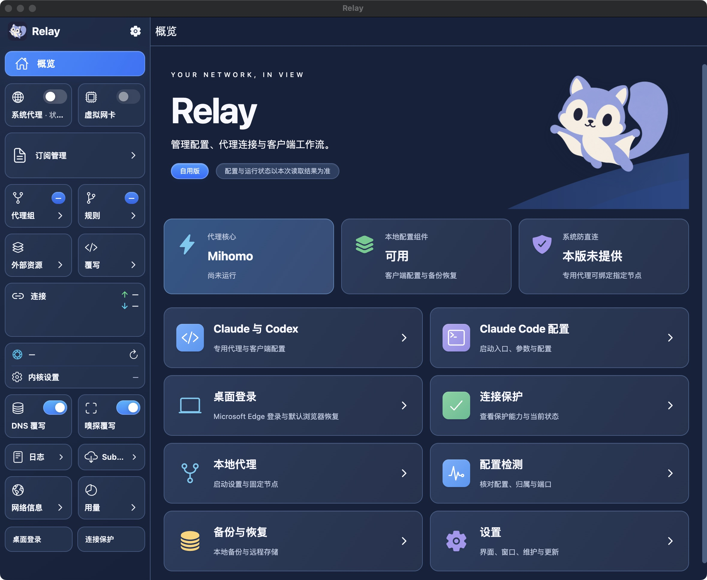
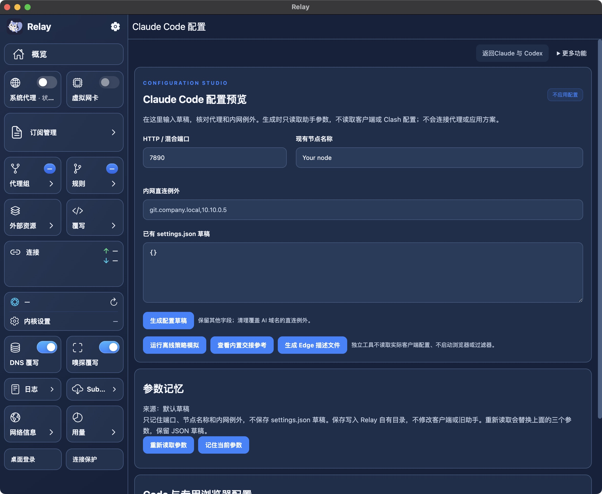

<div align="center">
  
  <h1>Relay</h1>
  <p><strong>macOS 上的代理管理与 AI 客户端网络工作区。</strong></p>
  <p><a href="https://haiyangdeng.github.io/Relay/">产品介绍</a> · <a href="https://github.com/haiyangdeng/Relay/releases/tag/v1.0.0">下载 V1.0.0</a> · <a href="docs/BUILD.md">源码构建</a> · <a href="https://github.com/haiyangdeng/Relay/issues">问题反馈</a></p>
</div>

Relay 基于 Clash Party 与 Mihomo，将配置、订阅、代理组、分流规则、连接和日志集中在一个 macOS 应用中，并提供 Claude / Codex 专用代理与 Claude Code 配置工作流。



以上及下方截图来自实际运行的软件，使用空白配置演示。

## 下载

需要 **macOS 13 或更新版本**。安装包包含 Relay App、系统代理管理员组件和自动卸载组件。

| Mac 类型                    | 安装包                                                                                                                   |
| --------------------------- | ------------------------------------------------------------------------------------------------------------------------ |
| Apple Silicon（M 系列芯片） | [Relay-1.0.0-macOS-arm64.pkg](https://github.com/haiyangdeng/Relay/releases/download/v1.0.0/Relay-1.0.0-macOS-arm64.pkg) |
| Intel                       | [Relay-1.0.0-macOS-x64.pkg](https://github.com/haiyangdeng/Relay/releases/download/v1.0.0/Relay-1.0.0-macOS-x64.pkg)     |

[版本说明与 SHA256SUMS](https://github.com/haiyangdeng/Relay/releases/tag/v1.0.0)。本版使用 **ad-hoc 签名，未使用 Developer ID，也未获 Apple 公证**。管理员组件安装需要 macOS 授权；安装器会拒绝覆盖已有 Relay 应用、组件或运行实例。

## 功能

- **代理工作区**：本地配置与订阅、代理组、节点选择与延迟检测、规则、DNS、嗅探、连接和日志。
- **系统代理**：管理遵循 macOS 系统代理设置的应用，保留 Relay 修改前的恢复记录。
- **AI 客户端配置**：Claude / Codex 专用代理；Claude Code 配置草稿、备份、应用与恢复。
- **浏览器与登录**：独立 Chrome 配置目录和专用代理入口；桌面登录的默认浏览器恢复流程。
- **日常操作**：菜单栏快捷操作、关闭窗口后后台运行、状态与流量统计、备份与恢复。
- **自动卸载**：将已安装的 `Relay.app` 拖入废纸篓后，由独立组件恢复 Relay 管理的配置并清理其进程、组件、登录项、专属数据、缓存与凭据，无需另跑卸载脚本。



## 使用范围

Relay 的专用代理处理实际进入该入口的流量。**V1.0.0 不提供系统级按进程防直连保证**；客户端忽略代理或命中 `NO_PROXY` 例外时，不能推断连接已受保护。

源码保留虚拟网卡（TUN）能力；TUN 需要匹配的额外组件。现有独立 TUN 安装包绑定构建用户，不作为面向任意用户的公开下载。本页的 App 一体安装包不包含通用 TUN 安装组件。

与其他代理软件交替使用时，应错开监听端口，并让一个软件管理系统代理或 TUN 路由。客户端配置不会因为同时打开两个软件而自动切换。更多说明见 [使用与保护范围](docs/USAGE.md)。

自动卸载会删除 Relay 的专属数据，请先导出需要保留的配置。无法确认归属或恢复失败时会保留恢复记录。本轮已完成退出／卸载离线回归、独立审阅、双架构打包及资源签名核对；**真实 Finder、系统权限和完整系统卸载链尚未进行本轮实机验收**。

## 本地开发

使用 Node.js 24、pnpm 11.8.0；原生构建需要 Xcode Command Line Tools，修改版 Mihomo 构建需要固定 Go 工具链。完整流程见 [BUILD](docs/BUILD.md)。

```sh
pnpm install --frozen-lockfile
pnpm run typecheck
pnpm run build:relay
```

`build:relay` 只编译界面与主进程，不安装 App、开启代理或生成安装包。原生资源与安装包使用独立的显式构建步骤。测试保留在 `src/`、`native/` 和 `scripts/relay/`；部分专项检查依赖 macOS 或预生成 fixture，不能把全部脚本视为开箱即跑的单元测试。

| 目录               | 内容                                    |
| ------------------ | --------------------------------------- |
| `src/`             | Electron 主进程、桥接、React 界面与测试 |
| `native/`          | Swift 原生集成、浏览器入口与管理员组件  |
| `core-extensions/` | 固定 Mihomo 上游版本及修改补丁          |
| `scripts/`         | 构建、资源准备与验证                    |
| `site/`            | GitHub Pages 产品介绍与下载页面         |
| `docs/`            | 使用、构建、许可来源及真实截图          |

公开源码不附带个人订阅、节点密码、运行日志或依赖目录。提交问题前请脱敏，参考 [SECURITY](SECURITY.md)。

## 来源与许可

Relay 是 Clash Party 的派生项目，不是其官方版本，也不属于 Anthropic、OpenAI 或 Microsoft。

- Clash Party 基线：**v2.0.4**，提交 `ac294fed972c0c25c641abe603c3a6fe709dfdb3`。
- Mihomo 和本地修改的固定来源、构建入口及补丁保留在 [`core-extensions/`](core-extensions/)。
- 保留 [GNU GPL v3 许可证](LICENSE)、[项目声明](NOTICE.md) 和 [第三方来源](docs/THIRD_PARTY_NOTICES.md)。第三方组件遵循各自许可证。
- 商标与现有美术素材的来源记录见 [ASSETS](docs/ASSETS.md)；源码许可证不自动覆盖第三方商标或未记录的素材权利。
